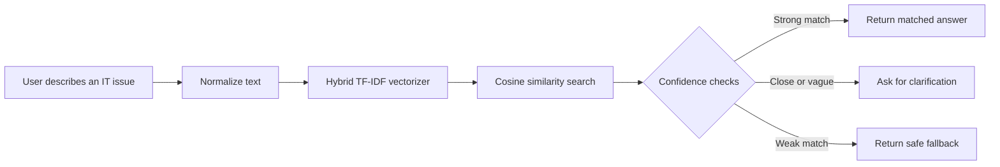

<div align="center">

# ◈ NEXUS IT Support Assistant

### Calm, fast answers for everyday technical problems.

<p>
  
  
  
  
</p>

<p>
  A beautiful, retrieval-based IT support assistant that matches user questions to a curated knowledge base using hybrid word and character TF-IDF similarity.
</p>

<p>
  <a href="#-quick-start">Quick Start</a> ·
  <a href="#-how-it-works">How It Works</a> ·
  <a href="#-api-reference">API Reference</a> ·
  <a href="#-deployment">Deployment</a>
</p>

</div>

---

## Suggested GitHub Repository Title

```text
nexus-it-support-assistant
```

## Suggested GitHub Repository Description

> A polished FastAPI and Gradio IT support chatbot powered by hybrid TF-IDF retrieval, confidence-aware matching, and a curated troubleshooting knowledge base.

## About the Project

**NEXUS IT Support Assistant** is a focused help-desk experience for common technical issues. Users describe what is not working in natural language, and NEXUS searches a structured support knowledge base to return the closest relevant troubleshooting answer.

Instead of pretending to know everything, NEXUS is deliberately confidence-aware. It can:

- Answer when a match is sufficiently strong.
- Ask for clarification when a question is vague.
- Avoid guessing when multiple issues are too similar.
- Explain when no reliable answer exists in the current knowledge base.

The project combines a custom, responsive HTML interface with a FastAPI backend and a lightweight Gradio test console.

## ✨ Experience Highlights

<table>
<tr>
<td width="50%">

### Intelligent retrieval

Hybrid TF-IDF retrieval combines word n-grams and character n-grams for more resilient matching across wording variations, typos, and partial phrases.

</td>
<td width="50%">

### Confidence-aware answers

Minimum similarity and top-result margin thresholds reduce unreliable answers and route uncertain questions into useful clarification states.

</td>
</tr>
<tr>
<td width="50%">

### Designed support workspace

A custom chat UI includes topic shortcuts, suggested questions, online/offline status, clear conversation controls, loading states, and accessible message rendering.

</td>
<td width="50%">

### Multiple interfaces

Use the polished main interface at `/` or open the plain Gradio test console at `/gradio` while developing and validating retrieval behavior.

</td>
</tr>
</table>

## 🖥️ Interface Preview

> Add a screenshot of your finished interface to the repository for the best GitHub presentation.
>
> ```md
> 
> ```

The interface is optimized around four common support areas:

| Topic | Example questions |
| --- | --- |
| Computer | “My computer won’t start” · “The screen is black” |
| Network | “Wi-Fi keeps disconnecting” · “Websites will not load” |
| Printer | “My printer is not detected” · “Printing fails” |
| Accounts | “I cannot log in” · “My account is locked” |

## 🧠 How It Works



### Retrieval pipeline

1. The support dataset is parsed into scenario records.
2. Duplicate interactions are reduced to one entry per underlying scenario.
3. User text is normalized for common variations such as `Wi-Fi`, `PC`, and contractions.
4. A `FeatureUnion` combines:
   - Word-level TF-IDF with 1–2 word n-grams.
   - Character-level TF-IDF with 3–5 character n-grams.
5. Cosine similarity ranks the closest support issue.
6. The result is accepted, clarified, or rejected using configurable thresholds.

## 🧱 Architecture

```text
┌─────────────────────┐      JSON       ┌──────────────────────────┐
│  Custom HTML / CSS  │ ──────────────▶ │  FastAPI application     │
│  + vanilla JS UI    │ ◀────────────── │  /api/chat + /api/health │
└─────────────────────┘                 └────────────┬─────────────┘
                                                     │
                                                     ▼
                                      ┌──────────────────────────┐
                                      │ Hybrid TF-IDF retriever  │
                                      │ + cosine similarity      │
                                      └────────────┬─────────────┘
                                                   │
                                                   ▼
                                      ┌──────────────────────────┐
                                      │ IT support knowledge base │
                                      └──────────────────────────┘

                    Optional developer console: /gradio
```

## 🛠️ Tech Stack

| Layer | Technology |
| --- | --- |
| Runtime | Python 3.9+ |
| API | FastAPI |
| Server | Uvicorn, included through Gradio dependencies |
| Retrieval | scikit-learn TF-IDF + cosine similarity |
| Numerical operations | NumPy |
| Test interface | Gradio |
| Main interface | HTML, CSS, vanilla JavaScript |

## 📁 Project Structure

```text
nexus-it-support-assistant/
├── app.py                              # FastAPI app and retrieval engine
├── index.html                          # Custom NEXUS web interface
├── requirements.txt                    # Python dependencies
├── it_support_chatbot_dataset_1000.txt # Required support knowledge base
├── assets/                             # Optional screenshots and static assets
└── README.md                           # Project documentation
```

> The uploaded project archive does not include `it_support_chatbot_dataset_1000.txt`. Add the dataset beside `app.py`, or set the `NEXUS_DATASET` environment variable to its location before starting the application.

## 🚀 Quick Start

### Prerequisites

- Python 3.9 or newer
- pip
- The support dataset file: `it_support_chatbot_dataset_1000.txt`

### 1. Clone the repository

```bash
git clone https://github.com/<your-username>/nexus-it-support-assistant.git
cd nexus-it-support-assistant
```

### 2. Create and activate a virtual environment

**macOS / Linux**

```bash
python3 -m venv .venv
source .venv/bin/activate
```

**Windows PowerShell**

```powershell
python -m venv .venv
.venv\Scripts\Activate.ps1
```

### 3. Install dependencies

```bash
python -m pip install --upgrade pip
pip install -r requirements.txt
```

### 4. Add the knowledge base

Place the dataset next to `app.py`:

```text
nexus-it-support-assistant/
├── app.py
├── index.html
├── requirements.txt
└── it_support_chatbot_dataset_1000.txt
```

To use another file location:

```bash
export NEXUS_DATASET=/path/to/your/support_dataset.txt
```

On Windows PowerShell:

```powershell
$env:NEXUS_DATASET = "C:\path\to\your\support_dataset.txt"
```

### 5. Run the app

```bash
python app.py
```

Open the main NEXUS interface at:

```text
http://127.0.0.1:7860
```

The developer test console is available at:

```text
http://127.0.0.1:7860/gradio
```

## 🔌 API Reference

### `GET /api/health`

Returns service status and the number of indexed records.

**Example response**

```json
{
  "status": "ok",
  "records": 42,
  "qa_pairs": 1000
}
```

### `POST /api/chat`

Retrieves the closest answer for a support question.

**Request**

```json
{
  "message": "My laptop keeps disconnecting from Wi-Fi"
}
```

**Successful response**

```json
{
  "status": "ok",
  "is_match": true,
  "answer": "Try restarting your router and reconnecting to the network...",
  "notice": null,
  "matched_question": "Wi-Fi keeps disconnecting",
  "similarity": 0.8142,
  "margin": 0.1731
}
```

### Possible retrieval states

| Status | Meaning |
| --- | --- |
| `ok` | A sufficiently strong match was found. |
| `clarify` | The question is too vague and needs one more detail. |
| `ambiguous` | Multiple issues are too close to safely choose one. |
| `no_match` | No knowledge-base answer met the confidence threshold. |
| `empty` | The user did not provide a question. |

## ⚙️ Configuration

The main retrieval controls are defined near the top of `app.py`:

```python
MIN_SCORE = 0.40    # Minimum cosine similarity for a trusted match
MIN_MARGIN = 0.06   # Minimum gap between first and second result
MAX_CHARS = 1200    # Maximum user message length
```

Adjust these values based on the quality and coverage of your support dataset:

- Increase `MIN_SCORE` for safer, more conservative answers.
- Decrease `MIN_SCORE` for broader but potentially less precise matching.
- Increase `MIN_MARGIN` when ambiguous results should trigger clarification more often.

## 🌐 Deployment

### Hugging Face Spaces

The project is compatible with a Gradio Space configuration:

```yaml
---
title: NEXUS IT Support Assistant
colorFrom: orange
colorTo: gray
sdk: gradio
app_file: app.py
---
```

Before deploying, make sure the dataset is included in the Space or provided through the Space's file environment. Never commit confidential support records or secrets to a public repository.

### Custom hosting

For a production deployment, run the application behind a process manager and reverse proxy. Set the `PORT` environment variable when required:

```bash
PORT=7860 python app.py
```

## 🔒 Safety and Privacy

NEXUS retrieves answers from a fixed knowledge base; it does not replace a human support professional. The interface intentionally warns users not to submit:

- Passwords
- Verification codes
- API keys
- Confidential company information
- Personal data not required for troubleshooting

Keep the dataset current, review retrieved answers periodically, and use a secure deployment for internal support content.

## 🧪 Example Questions

Try asking:

```text
My laptop cannot connect to Wi-Fi
The screen stays black when I turn on my computer
My printer shows as offline
How do I reset my password?
```

## 🗺️ Roadmap

- [ ] Add answer feedback and retrieval-quality analytics.
- [ ] Support multilingual troubleshooting queries.
- [ ] Add category filters and issue history.
- [ ] Add an admin workflow for updating the knowledge base.
- [ ] Add semantic embeddings as an optional retrieval backend.
- [ ] Add automated tests for normalization and confidence thresholds.
- [ ] Add Docker and CI/CD configuration.

## 🤝 Contributing

Contributions are welcome.

1. Fork the repository.
2. Create a branch: `git checkout -b feature/improve-retrieval`.
3. Make your changes and add tests where appropriate.
4. Commit your work: `git commit -m "Improve retrieval confidence handling"`.
5. Push the branch and open a pull request.

Please keep the API response format backward-compatible and avoid exposing sensitive dataset content in logs or tests.

## 📄 License

Add a `LICENSE` file before publishing this project. The MIT License is a practical choice for an open-source version of this application.

---

<div align="center">

**NEXUS** · Support answers with less noise and more confidence.

</div>
